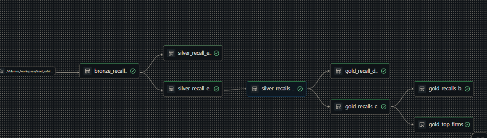
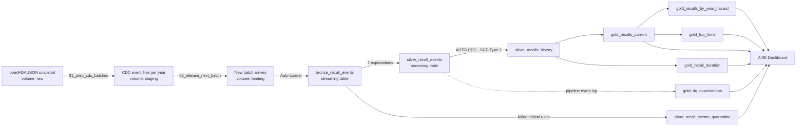
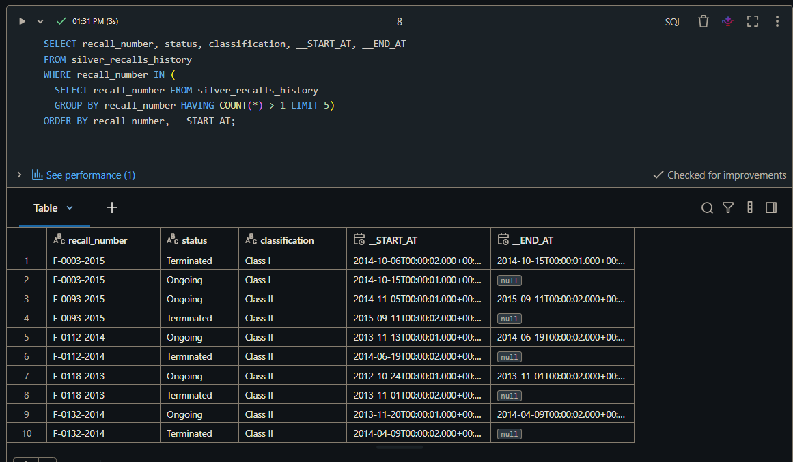
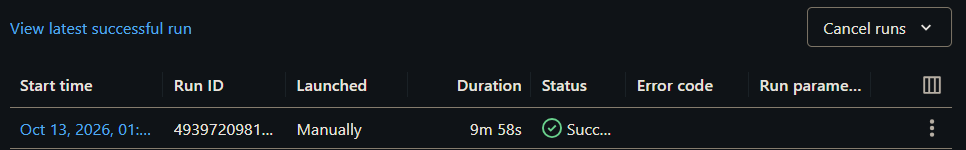
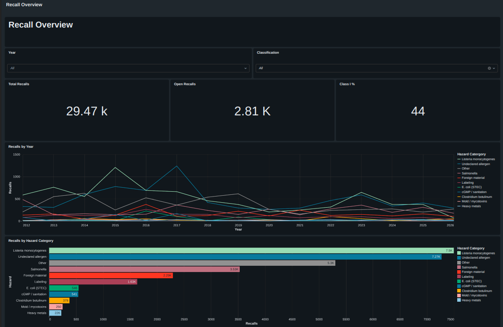
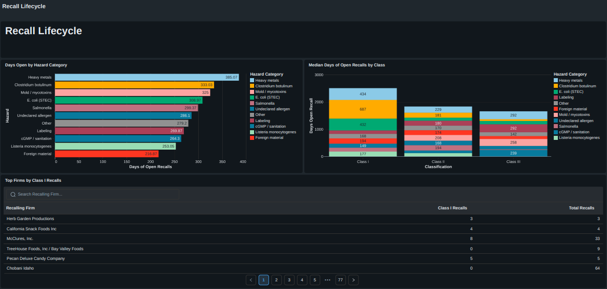
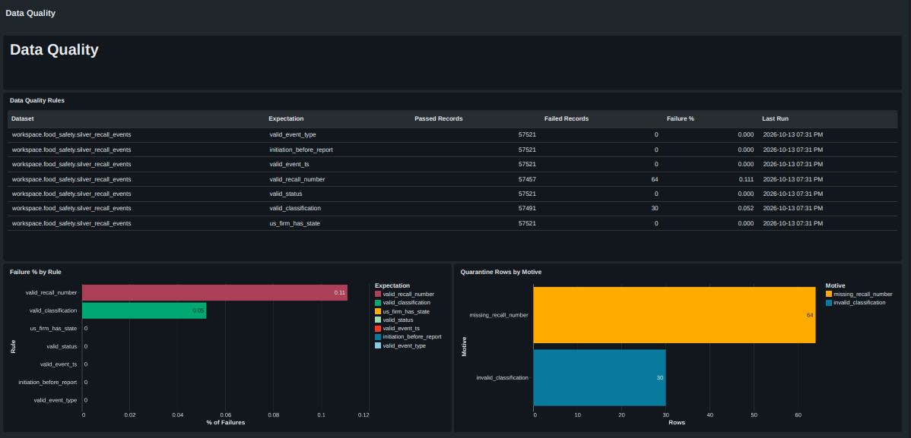

# FDA Food Recalls Lakehouse

An incremental lakehouse on **Databricks** that ingests U.S. FDA food recall events in batches, enforces measurable data-quality rules with a quarantine table, and keeps the full status history of every recall with **SCD Type 2**. The pipeline is built with **Lakeflow Declarative Pipelines** (formerly Delta Live Tables), orchestrated with **Lakeflow Jobs**, and published as a three-page **AI/BI dashboard**.

The domain is food safety, which is also my academic background (M.Sc. in Food Science & Technology). Recall reasons are mapped to hazard categories the way a food-safety professional would group them: biological, allergen, chemical, physical and GMP hazards.



---

## Key results

| Metric | Value |
|---|---|
| Recalls in the source snapshot (openFDA Food Enforcement) | **29,469** |
| CDC events generated and ingested (Bronze) | **57,521** |
| Incremental batches (one file per year, 2012–2026) | **15** |
| Events that passed critical quality rules (Silver) | **57,427** |
| Events quarantined | **94** (0.163%) |
| Recalls with more than one SCD2 version | **27,958** |
| Data-quality expectations | **7** (4 drop, 1 fail, 2 warn) |
| Cost | **$0** (Databricks Free Edition, serverless) |

---

## Architecture



| Layer | Object | Type | Purpose |
|---|---|---|---|
| Bronze | `bronze_recall_events` | Streaming table | Raw events as they land, plus `source_file` and `ingestion_ts` for lineage |
| Silver | `silver_recall_events` | Streaming table | Typed, trimmed and validated events with a `hazard_category` column |
| Silver | `silver_recall_events_quarantine` | Streaming table | Rows rejected by critical rules, with the `failed_rule` that caught them |
| Silver | `silver_recalls_history` | Streaming table (AUTO CDC) | SCD Type 2 history: one row per status/classification version |
| Gold | `gold_recalls_current` | Materialized view | Current version of every recall |
| Gold | `gold_recalls_by_year_hazard` | Materialized view | Recalls by report year, hazard category and classification |
| Gold | `gold_recall_duration` | Materialized view | Average and median days a recall stays open (only possible thanks to SCD2) |
| Gold | `gold_top_firms` | Materialized view | Firms with 3+ recalls and their Class I count |
| Gold | `gold_dq_expectations` | Delta table | Passed/failed records per expectation, read from the pipeline event log |

---

## Tech stack

Databricks Free Edition · Unity Catalog (schemas and volumes) · Auto Loader (`read_files`) · Lakeflow Declarative Pipelines · Expectations · AUTO CDC (SCD Type 2) · Materialized views · Delta Lake · Lakeflow Jobs · AI/BI Dashboards · Spark SQL · PySpark · Git folders + GitHub

---

## Dataset and CDC simulation

**Source:** [openFDA Food Enforcement](https://open.fda.gov/apis/food/enforcement/), the public record of U.S. food recalls. Each record contains the recall number, firm, product, reason for recall, risk classification (Class I = may cause serious harm or death; Class III = unlikely to cause harm) and status.

The download is a **snapshot**: it shows only the current state of each recall. To practise change data capture, I **rebuilt a CDC feed from the dates in the snapshot** to simulate incremental data arrival:

| Event | Timestamp used | Status carried |
|---|---|---|
| `INITIAL` | `report_date` (FDA publishes the recall) + 1 s | `Ongoing` if the recall was later terminated, otherwise its current status |
| `STATUS_CHANGE` | `termination_date` (FDA closes the recall) + 2 s | `Terminated` |

The 1 s / 2 s offsets keep two events from the same day from tying in the SCD2 sequence. Events are grouped by year into `recall_events_YYYY.json` files in the `staging` volume. `02_release_next_batch` copies the next pending file(s) into `landing`, which simulates a provider dropping new files.

To prove the quality rules work, the notebook also **injects controlled errors** from the 2020 batch onward: ~0.3% of rows with a null `recall_number` and ~0.2% with an invalid classification (`Class X`).

---

## Pipeline

### Bronze: incremental ingestion with Auto Loader

[`01_bronze.sql`](pipeline/food_safety_recalls_pipeline/transformations/01_bronze.sql) reads `landing` with `STREAM read_files(...)`. Auto Loader keeps a checkpoint of the files it has already ingested, so each batch is processed **exactly once**, no matter how many times the pipeline runs. No control table is needed.

### Silver: cleaning, hazard classification and data quality

[`02_silver.sql`](pipeline/food_safety_recalls_pipeline/transformations/02_silver.sql) casts dates, trims firm names and applies seven expectations. All three expectation actions are used, each for a different kind of problem:

| Expectation | Rule | Action | Failed records |
|---|---|---|---|
| `valid_recall_number` | `recall_number IS NOT NULL` | DROP ROW | **64** (0.111%) |
| `valid_classification` | `classification IN ('Class I','Class II','Class III')` | DROP ROW | **30** (0.052%) |
| `valid_event_ts` | `event_ts IS NOT NULL` | DROP ROW | 0 |
| `valid_status` | `status IN ('Ongoing','Completed','Terminated')` | DROP ROW | 0 |
| `valid_event_type` | `event_type IN ('INITIAL','STATUS_CHANGE')` | FAIL UPDATE | 0 |
| `initiation_before_report` | `recall_initiation_date <= report_date` | WARN | 0 |
| `us_firm_has_state` | U.S. firms must have a state | WARN | 0 |

- **DROP ROW** for unusable data (no business key, invalid classification)
- **FAIL UPDATE** when the feed itself is broken (an unknown event type stops the pipeline)
- **WARN** for issues that are worth measuring but don't invalidate the record

Dropped rows are not lost silently: `silver_recall_events_quarantine` stores them with the rule that caught them. The 94 quarantined rows match the injected errors exactly (64 `missing_recall_number` + 30 `invalid_classification`).

**Hazard classification.** A `CASE` expression maps `reason_for_recall` to 11 hazard categories: *Listeria monocytogenes*, *Salmonella*, *E. coli* (STEC), *Clostridium botulinum*, undeclared allergens, heavy metals, mold/mycotoxins, foreign material, cGMP/sanitation, labeling and other. The order of the conditions matters. For example, heavy metals (lead, arsenic, cadmium, mercury: a chemical hazard) are evaluated before the generic "metal" keyword (metal fragments: a physical hazard).

### Silver: SCD Type 2 with AUTO CDC

[`03_silver_scd2.sql`](pipeline/food_safety_recalls_pipeline/transformations/03_silver_scd2.sql):

```sql
CREATE FLOW recalls_scd2_flow AS AUTO CDC INTO silver_recalls_history
FROM STREAM(silver_recall_events)
KEYS (recall_number)
SEQUENCE BY event_ts
COLUMNS * EXCEPT (event_type, source_file, ingestion_ts)
STORED AS SCD TYPE 2
TRACK HISTORY ON status, classification;
```

`SEQUENCE BY` puts late or out-of-order events in their correct place. `TRACK HISTORY ON` creates a new version only when status or classification changes. Each recall closes its `Ongoing` version and opens a `Terminated` one:



*F-0093-2015, F-0112-2014, F-0118-2013 and F-0132-2014 show the expected `Ongoing → Terminated` history. F-0003-2015 is a source-data edge case explained in [Known limitations](#known-limitations).*

With SCD Type 1 (a plain `MERGE`), the `Ongoing` version would be overwritten and questions like "how many days did this recall stay open?" could not be answered.

### Gold: materialized views

[`04_gold.sql`](pipeline/food_safety_recalls_pipeline/transformations/04_gold.sql) builds four materialized views that refresh with the pipeline. `gold_recall_duration` computes `datediff(__END_AT, __START_AT)` on closed `Ongoing` versions, which uses the SCD2 history directly.

---

## Orchestration

`food_safety_recalls_job` ([YAML](jobs/food_safety_recalls_job.yml)) runs the full lifecycle of one batch:

1. **`01_release_next_batch`**: notebook that moves the next file(s) from `staging` to `landing` (`batches_to_release` parameter)
2. **`02_run_food_safety_recalls_pipeline`**: triggers the declarative pipeline (Triggered mode, serverless)
3. **`03_data_quality_snapshot`**: reads the pipeline event log with `event_log()` and rebuilds `gold_dq_expectations`

The pipeline transforms; the job orchestrates everything around it (data arrival and quality metrics).



---

## Dashboard

Three pages built on the Gold tables. Exports: [`.lvdash.json`](dashboards/Food_safety_recalls_dashboard.lvdash.json) · PDFs: [Overview](dashboards/Recalls_overview_dashboard.pdf) · [Lifecycle](dashboards/Recalls_lifecycle_dashboard.pdf) · [Data Quality](dashboards/DQ_dashboard.pdf)

### Recall Overview
KPIs (total recalls, open recalls, % Class I), recalls per year by hazard category, and the hazard ranking, with year and classification filters.



### Recall Lifecycle
Average days open by hazard category, median days open by classification, and the firms with the most Class I recalls.



### Data Quality
Passed/failed records and failure rate for each expectation, plus quarantined rows by reason. In production, this is the first page to check when something goes wrong.



### Insights

- **44%** of recalls are **Class I**, the highest-risk classification.
- ***Listeria monocytogenes*** (~7.5k) and **undeclared allergens** (~7.3k) account for roughly half of all recalls, followed by *Salmonella* (~3.5k).
- Recalls caused by **heavy metals** stay open the longest (~385 days on average), followed by *C. botulinum* (~333) and mold/mycotoxins (~325). Foreign-material recalls close fastest (~217 days).
- Listeria-related recalls peaked in 2015 and undeclared-allergen recalls peaked in 2017.

---

## Known limitations

- **Termination recorded before publication.** In the source data, **1,750 recalls** have a `termination_date` earlier than their `report_date`. With event-time sequencing, their `STATUS_CHANGE` event lands *before* the `INITIAL` event, so SCD2 keeps `Ongoing` as the current version (see F-0003-2015 above). As a result, the **open-recalls KPI (2,813) is overstated**: about 1,063 recalls are actually open. A fix would place the termination event right after the report date and add a WARN expectation (`termination_date >= report_date`) to keep measuring the anomaly.
- **Simulated CDC.** The change feed is reconstructed from snapshot dates. It reflects only the publication and termination events, not every intermediate status or classification change the FDA may have made.
- **Synthetic errors.** The quarantined rows come from deliberately injected errors that demonstrate the quality rules. They are not defects in the FDA data.
- **Keyword-based hazard mapping.** About 5.3k recalls fall into "Other". A richer taxonomy or an NLP model would reduce that bucket.
- **Not for medical decisions.** openFDA data is not validated for clinical or regulatory decision-making. This is a portfolio project.

---

## Repository structure

```
fda-food-recalls-lakehouse/
├── README.md
├── notebooks/
│   ├── 00_setup.sql                    # schema + raw/staging/landing volumes
│   ├── 01_prep_cdc_batches.py          # snapshot → CDC events, one file per year
│   ├── 02_release_next_batch.py        # simulates the arrival of new batches
│   ├── 03_data_quality_snapshot.sql    # event log → gold_dq_expectations
│   └── 04_validation_queries.sql       # incrementality, quarantine and SCD2 checks
├── pipeline/
│   └── food_safety_recalls_pipeline/
│       └── transformations/
│           ├── 01_bronze.sql
│           ├── 02_silver.sql
│           ├── 03_silver_scd2.sql
│           └── 04_gold.sql
├── jobs/
│   └── food_safety_recalls_job.yml
├── dashboards/
│   ├── Food_safety_recalls_dashboard.lvdash.json
│   ├── Recalls_overview_dashboard.pdf
│   ├── Recalls_lifecycle_dashboard.pdf
│   └── DQ_dashboard.pdf
└── docs_imgs/                          # screenshots used in this README
```

---

## How to reproduce

1. Create a free workspace on [Databricks Free Edition](https://www.databricks.com/learn/free-edition) and clone this repo as a **Git folder**.
2. Run `notebooks/00_setup.sql` to create the `workspace.food_safety` schema and the `raw`, `staging` and `landing` volumes.
3. Download [`food-enforcement-0001-of-0001.json.zip`](https://download.open.fda.gov/food/enforcement/food-enforcement-0001-of-0001.json.zip), unzip it, and upload the JSON to the `raw` volume.
4. Run `notebooks/01_prep_cdc_batches.py` once to generate the yearly batch files in `staging`.
5. Create an ETL pipeline with `pipeline/food_safety_recalls_pipeline` as the root folder (catalog `workspace`, schema `food_safety`, serverless, **Triggered** mode).
6. Create the job from `jobs/food_safety_recalls_job.yml`, replacing `<your-user>` and the `pipeline_id`. Each **Run now** releases one batch, runs the pipeline and refreshes the quality metrics.
7. Import `dashboards/Food_safety_recalls_dashboard.lvdash.json` to recreate the dashboard.

To restart the simulation, empty `landing` and run the pipeline with **full table refresh**.

---

## Next steps

- Package the project as a **Databricks Asset Bundle** with pytest tests for the hazard classification and CI/CD via GitHub Actions.
- Replace manual runs with a **file-arrival trigger** on the `landing` volume.
- Fix the termination-before-report sequencing described in Known limitations.
- Enrich recalls with **USDA FoodData Central** food categories to cross food type × hazard type.
- Add point-in-time queries on the SCD2 history (e.g., Class I recalls still open at the end of each year).
- Use `gold_recalls_current` as a data source for my Food Safety AI Agent project.

---

## Author

**Juan Carlos Jiménez Oliver** · Junior AI/Data Engineer · M.Sc. Food Science & Technology  
[GitHub](https://github.com/Jc-Oliver97) · [LinkedIn](https://www.linkedin.com/in/jc-jimenez-oliver)
